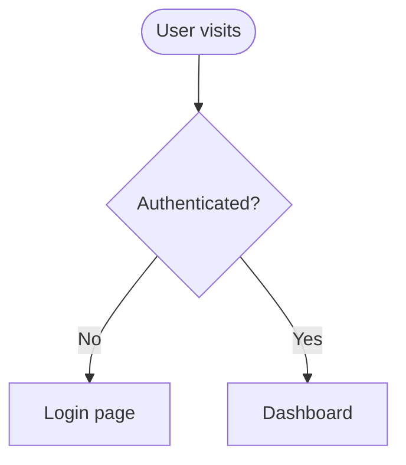

# Diagrams

Two output modes. Pick by destination:

| Destination | Mode |
|---|---|
| Markdown platform (GitHub, Obsidian, Notion) or user asks for Mermaid | **Mermaid** `.mmd` / fenced block |
| Checked-in visual artifact for docs, slides, handoff specs | **Hand-authored SVG** |

## Mermaid

Type selection: `flowchart` (processes, user journeys, decision trees) ·
`sequenceDiagram` (API flows, auth, interactions) · `classDiagram` (domain models) ·
`erDiagram` (schemas) · `stateDiagram-v2` (component/UI state machines) ·
`C4Context/Container` (architecture) · `gantt` (timelines).

Rules of thumb:
- One concept per diagram; split rather than cram.
- `%%` comments for complex relationships; avoid `{}` inside comments (breaks parse).
- Meaningful node labels — diagrams should be self-documenting.
- Theme via frontmatter (`config.theme: base` + `themeVariables`) to match project palette.
- Store `.mmd` beside the code/doc it explains; export via `mmdc -i in.mmd -o out.png` when a raster is needed.

UI-designer specials: user-journey flowcharts with swimlane subgraphs per persona;
`stateDiagram-v2` for component state charts (idle → loading → success/error) — pairs
directly with the States section of a handoff spec.

## Blueprint SVG

For polished node-and-edge visuals, author SVG directly:

- Grid-aligned layout (multiples of 8px), generous whitespace.
- Limited palette: one line color, one accent, neutral fills; 1.5px strokes.
- Node types: rounded-rect boxes, cylinders for stores, dashed groups for boundaries.
- Orthogonal edge routing with small arrowheads; 12–13px labels, sans-serif.
- Save to the consuming folder (`docs/`, `handoff/`, or app README assets).

## When Asked to "Diagram the Design System"

Default deliverables: token-flow diagram (brand input → generator → tokens.json →
CSS/SCSS/Tailwind views → components) and a component-hierarchy diagram
(primitives → composites → patterns → pages).
